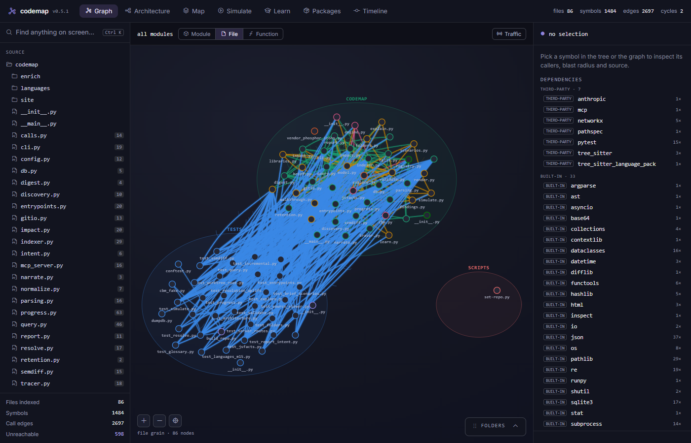
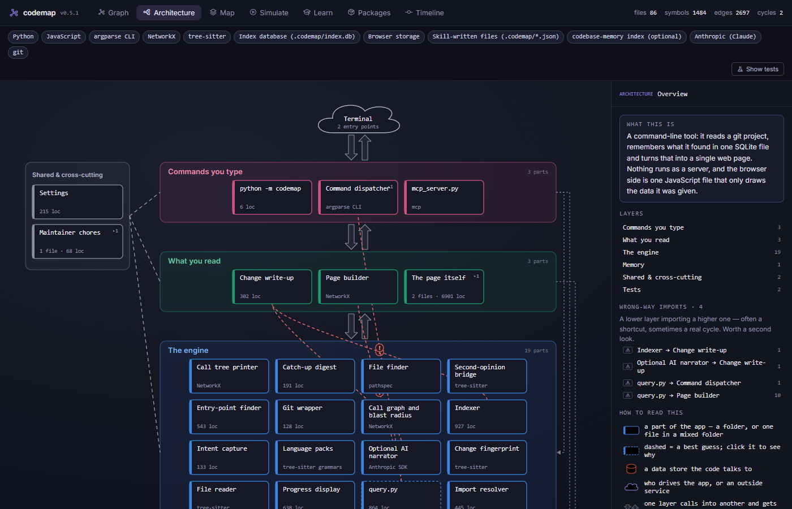
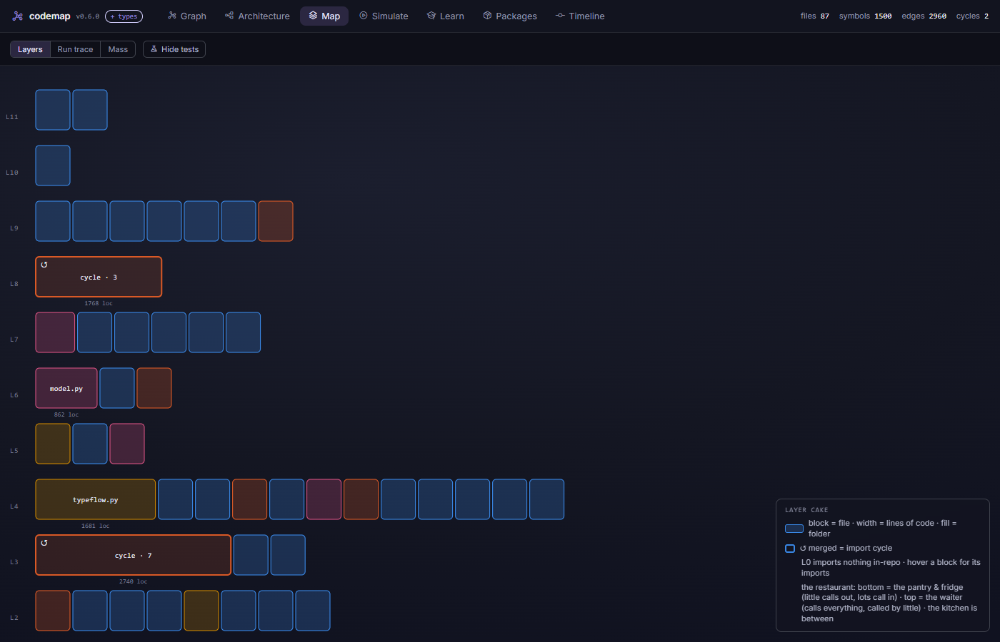
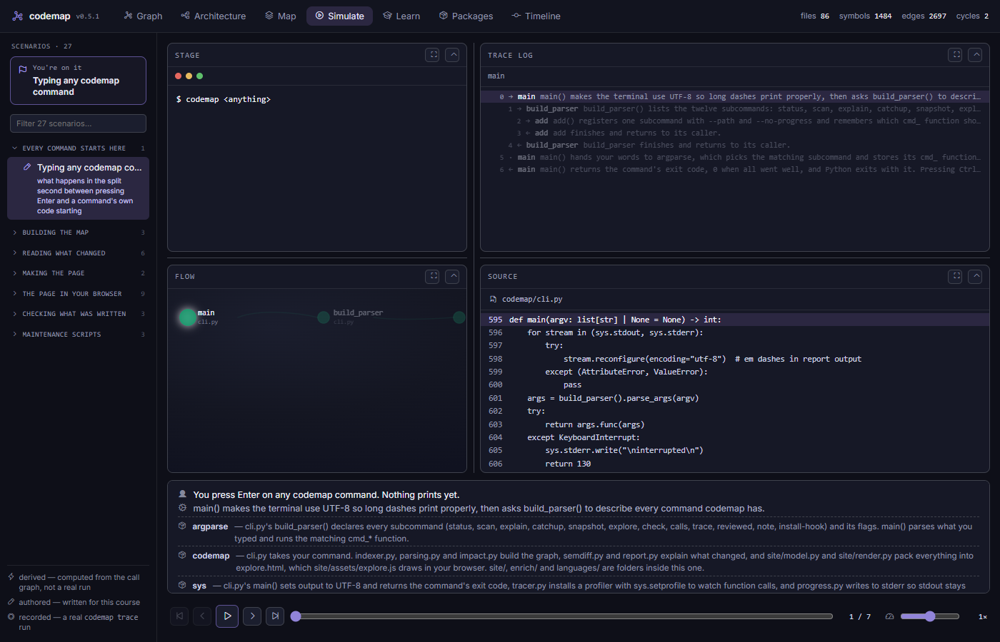
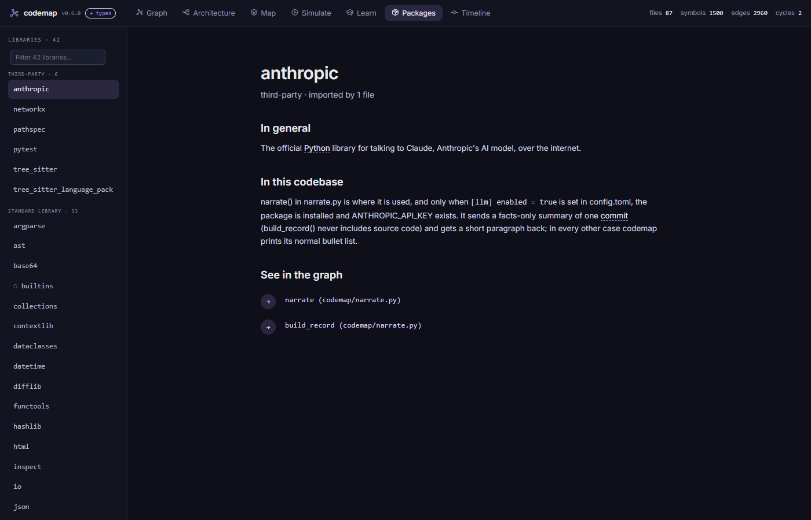
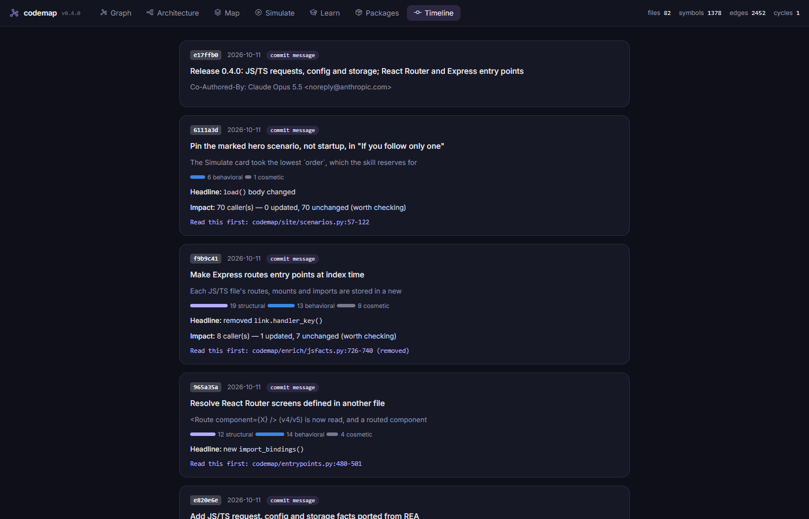

# codemap — understand a codebase you didn't write

[](https://github.com/devanr29/codebase-to-learn/actions/workflows/ci.yml)
[](LICENSE)

`codemap` keeps a symbol-level graph rooted in **the worktree** — the code as
it is on disk right now, uncommitted changes included — and renders it as one
self-contained, double-click-to-open HTML page. It is built for whoever has to
get productive in an unfamiliar repo: a new hire, a reviewer, or the person who
generated it with AI and now has to own it. After every commit, it also answers:

> What changed, why, what does it affect, and which forty lines should I read myself?



## Three pieces

|  | **The tool** | **The MCP server** | **The skills** |
|---|---|---|---|
| What | the `codemap` CLI | `codemap mcp` | a Claude Code plugin |
| Install | `pipx install git+https://github.com/devanr29/codebase-to-learn` | included with the tool | `/plugin install codemap@codemap` |
| Does | indexes your repo, explains diffs, renders `explore.html` | lets an AI assistant query the graph and settle what static analysis can't, with `file:line` evidence | drives that investigation, then authors the prose `explore.html` can't derive |
| Optional? | — | yes | yes — every tab has a deterministic fallback with zero authored content |

```
codemap scan → index.db → codemap mcp ⇄ AI assistant (open questions → evidence → verified answers)
                    │                         │
                    │      .codemap/{findings,walkthrough,libraries,explanations,scenarios,glossary,architecture}.json
                    ▼                         ▼
              codemap explore  ───────────►  explore.html   (reviewed facts are marked as such)
```

Static analysis can't tell which of two same-named functions a call reaches, or
which route serves a request built from a variable. The assistant can, by
reading the code, and `codemap mcp` only accepts an answer whose evidence
exists in the index. See [`docs/mcp.md`](docs/mcp.md) for the tools and the
questions, and [`docs/skills.md`](docs/skills.md) for how the pieces fit
together.

## Quickstart

```
pipx install git+https://github.com/devanr29/codebase-to-learn
cd your-repo
codemap scan
codemap explore --open
```

`scan`/`explore`/`trace` show live progress in a terminal (plain lines when
redirected — see "Progress output" in [`docs/cli.md`](docs/cli.md)). That's
the whole tool. Full flag reference: [`docs/cli.md`](docs/cli.md).
Full walkthrough of the rendered page: [`docs/explore-guide.md`](docs/explore-guide.md).
More install options (uv, from source, Windows notes, the plugin):
[`docs/install.md`](docs/install.md).

Two more commands, for the prose the skill writes and for the call graph
behind it:

```
codemap check                    # are the authored explanations, scenarios and links still true of the code?
codemap calls build_report --in  # what really calls this, with file:line and how sure codemap is
```

## The seven tabs

| Tab | Answers | |
|---|---|---|
| **Graph** | What calls what — source tree, a neural-style code graph, focus any symbol to see its callers/callees, blast radius, and source. |  |
| **Architecture** | What the system is made of — layers from routes down to data, the tech each part is built on, and the databases and outside services it talks to. |  |
| **Map** | What shape is the system, and where — dependency layers, a subway-map run trace, a treemap of the whole repo. |  |
| **Simulate** | What happens when it *runs* — a transport-controlled animation of one call-by-call scenario, with a scrollable trace log. |  |
| **Learn** | A guided tour of the codebase — what its parts are, how they fit together, and what each folder is for. | _walkthrough — see [`docs/explore-guide.md`](docs/explore-guide.md)_ |
| **Packages** | What every dependency and repo module actually does, in general and in this codebase. |  |
| **Timeline** | Every commit, its stated intent, and its blast radius. |  |

Icons are vendored into the page itself (base64, no CDN) — they render the
same offline or on a network that blocks arbitrary CDNs. The body font
degrades gracefully if Google Fonts is unreachable. The generated page never
calls an LLM. It also works on a phone: side menus stack above the content,
and controls grow to finger size on touch screens.

## Web requests, settings and browser storage

The call graph has no edge across a web request, so a screen calling `/api/x`
and the handler serving it would never meet. codemap reads both ends out of the
code itself:

- **Request → handler links.** JS/TS `fetch` / `axios` / `ky`-style calls (a URL
  built with `${id}` becomes `/api/orders/:param`) and Python `requests` /
  `httpx` / `aiohttp` / test-client calls (an f-string URL the same way) are
  paired with the routes that serve them: Express routes, prefixes from
  `app.use('/api/orders', router)` included, and Python Flask / FastAPI routes.
  A React screen calling a FastAPI handler pairs like any other. Simulate walks
  from the client call into the handler, the Architecture tab draws a labelled
  dashed connector, and the brief lists each link.
- **Settings** (JS/TS). Every `process.env` / `import.meta.env` / `process.argv`
  read, with its `||` / `??` default, listed in the brief.
- **Browser storage** (JS/TS). `localStorage` / `sessionStorage` / IndexedDB /
  Cache Storage keys, shown as a store on the Architecture tab.

The JS/TS detection rules are ported from [REA](https://github.com/morluto/rea)
(MIT), re-expressed over tree-sitter; codemap adds the URL patterns, mounts,
the Python side and the pairing. Set `native = "off"` under `[engine]` to skip
them.

## Type-aware call resolution (Python, JavaScript, TypeScript)

A name match can't tell `self.repo.get()` (a `Repo`) from `cache.get()` (a
dict). For Python, JavaScript and TypeScript, codemap also works out what each
call's receiver *is*: parameter and return annotations, `x = Foo()` and
`new Foo()`, `self.x = ...` / class fields / constructor parameter properties,
imports followed through `__init__.py` and barrel re-exports, base classes and
`super()`, `await`, `for x in items: list[Foo]` and `as Foo` casts. Then:

- a call it resolves becomes a link, even where the name match had none (a
  method on a field, a `new` expression), and a method call also reaches every
  override in a repo subclass, since that is what can run;
- an `AMBIGUOUS` name-only guess it settles is confirmed, and the wrong ones
  are removed, but only when *every* call to that name from that function is
  decided;
- a call on a builtin or third-party value (`dict.get`, `requests.get`,
  `console.log`) is ruled out as a repo call.

Anything unsure stays as the name match left it: a variable bound to two types,
an interface or `Protocol`, an abstract method with no override. Links it added
or confirmed carry a `typed` tag in the Graph inspector, and the topbar's
`+ types` badge says how many. The design is a port of
[codebase-memory-mcp](https://github.com/DeusData/codebase-memory-mcp)'s
"Hybrid LSP" resolver (MIT), written in Python over codemap's own parse, so
nothing else needs installing. Set `types = "off"` under `[engine]` in
`.codemap/config.toml` to keep the plain name-based graph.

## Known blind spots

- Dynamic imports, `getattr`/dictionary dispatch, string-based routing,
  dependency injection, and wrapping decorators are invisible or distorted in
  the graph — the Map tab's Run trace marks where a chain hits one of these
  instead of silently stopping.
- Caller resolution is receiver-aware: a `self.x()`/`Class.x()` call only
  resolves against that class, and a call on a variable needs import
  evidence to resolve at all (a stoplist of common container/IO names like
  `.get`/`.then`/`.json` blocks even that). In Python, JavaScript and
  TypeScript, type resolution (above) fills in most of what that misses; in
  the other languages it doesn't run. A **bare call** it can't settle still
  falls back to a repo-wide name match when nothing more specific applies, so
  false positives remain possible there — always within the same language
  family, never into a test file from production code. Confidence
  (`EXTRACTED`/`INFERRED`/`AMBIGUOUS`) is shown per edge; the Graph tab draws
  an `AMBIGUOUS` edge dashed and leaves it out of fan-in/fan-out and blast
  radius.
- Go and Rust methods show up with a flat name, not `Type.method` — see
  [`docs/spec.md`](docs/spec.md) §14.
- A folder that contains no file in an indexed language (docs-only, data-only,
  a Markdown-only skill directory) never enters the index, so it gets no row
  in the Map tab's treemap, no folder page in Learn, and no entry in the
  folder brief the `codebase-to-course` skill reads from — there's nothing to
  derive it from. Nothing breaks; that folder is just invisible to the tool.
- The Architecture tab's layers are a scored guess from folder names, file
  names, entry points and imports. Folders that don't say what they are end
  up as dashed best-guess boxes in Logic. A database or service the code
  reaches with no import and no manifest entry (a plain HTTP call, a
  connection URL read from the environment) doesn't appear until
  `.codemap/architecture.json` adds it — see [`docs/spec.md`](docs/spec.md) §18.
- Impact analysis is structural only; it can't tell you whether a change is
  *correct*.
- Intent marked `inferred` is a guess, not a record.

Full detail, including the tiered-accuracy model and per-language coverage,
in [`docs/spec.md`](docs/spec.md).

## Contributing

```
python -m venv .venv
.venv/Scripts/python -m pip install -e ".[dev]"
python -m pytest
```

See [`CONTRIBUTING.md`](CONTRIBUTING.md) for the full setup, the one
generated asset you should never hand-edit, and PR expectations.

## License

MIT — see [`LICENSE`](LICENSE).
